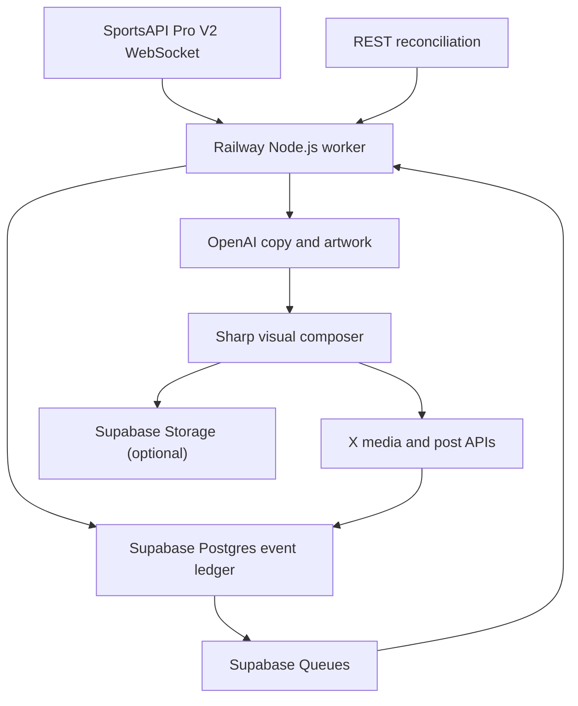

# Premier League AI Commentary Bot — Implementation Plan

**Date:** 15 August 2026  
**Target stack:** Node.js 22, TypeScript, Supabase Postgres, Supabase Queues  
**Recommended data provider:** SportsAPI Pro Football V2  
**Publishing destination:** X (Twitter) API v2  
**Currency:** USD, before taxes

## 1. Product goal

Build an automated account that detects important live Premier League events, writes short punchy commentary with playful football banter, creates an event-matched AI illustration, and publishes the text and image to X quickly and reliably.

The MVP should cover every Premier League fixture but should not tweet every incident. The default publishing policy should be:

| Event | Default | Timing |
|---|---:|---|
| Confirmed goal | Publish | After an 8–15 second confirmation window |
| Goal overturned by VAR | Publish correction only if the goal post escaped the delay | Immediately |
| Red card | Publish | After incident confirmation |
| Penalty missed/saved | Publish | After outcome confirmation |
| Full time | Publish | After final status is stable |
| Kick-off / half-time | Disabled | Enable only for selected fixtures |
| Yellow card | Disabled | Too frequent unless contextually important |
| Routine substitution | Disabled | Too frequent unless a debut/return/milestone is known from trusted data |

This should produce roughly **140–180 posts per active month** across the whole league, rather than 600–800 low-value posts.

## 2. Recommended experience

Each post should contain:

1. A factual event line: player, minute, score and event type.
2. One short commentary or banter line.
3. A distinctive 1:1 editorial illustration in the two teams’ colour palette.
4. A deterministic score/minute overlay rendered by code, not by the image model.
5. Descriptive alt text saying that the artwork is AI-generated.

Illustrative example:

> ARSENAL HAVE FOUND THE DOOR — AND CHELSEA LEFT IT WIDE OPEN. ⚽  
> Saka, 67'. Arsenal 2–1 Chelsea. North London is making noise.

The example is a format demonstration only; production text must use facts supplied by the live event feed.

### Banter settings

Expose a configuration value per competition or account:

- `neutral`: energetic commentary, almost no teasing.
- `playful` (default): light rivalry jokes and football idioms.
- `spicy`: sharper jokes, still within the safety rules.

Always prohibit slurs, protected-class references, abuse about appearance, mockery of injury or tragedy, sexual content, referee-corruption claims, match-fixing allegations, betting advice, and invented facts. Banter should target the football moment or team performance—not a person’s identity.

## 3. System architecture



### Components

- **Fixture scheduler:** Synchronizes the current Premier League season and schedules pre-match preparation.
- **Railway Node.js worker:** Maintains the SportsAPI Pro V2 WebSocket connection, consumes queues, renders images with `sharp` and publishes to X.
- **REST reconciler:** Fetches current match incidents after reconnects, suspicious score changes and final whistle. This prevents missed events.
- **Normalizer:** Converts provider payloads into a stable internal `MatchEvent` schema.
- **Supabase Postgres event ledger:** Stores every fixture, provider event, state transition, content attempt and X post ID.
- **Supabase Queues:** Uses the managed `pgmq` extension for durable jobs, visibility timeouts, retries and archival. Use logged Basic Queues, not Unlogged Queues.
- **Supabase Storage (optional):** Keeps final generated artwork in a private bucket for audit or reuse. The worker can instead stream the image directly to X when retention is unnecessary.
- **Copy service:** Calls an inexpensive text model and requires schema-constrained JSON.
- **Visual service:** Uses an AI-generated fixture background and `sharp` to add accurate event information.
- **Publisher:** Uploads the image, attaches alt text and creates the post through X API v2.
- **Admin controls:** Pause switch, dry-run mode, per-event enablement, account tone and manual approval mode.

### Supabase deployment boundary

Do not use a Supabase Edge Function as the primary live listener or image renderer. Paid Edge Functions have a 400-second wall-clock limit, persistent WebSocket connections are eventually terminated, and the hosted runtime does not support `sharp`/`libvips`. Keep the always-on worker on Railway.

Supabase Edge Functions remain suitable for short-lived operations such as the X OAuth callback, admin actions, manual approvals and lightweight webhooks.

### Queue design

Enable the Supabase Queues integration and create these logged Basic Queues:

- `event-confirmation`
- `content-generation`
- `image-generation`
- `x-publishing`
- `post-corrections`
- `dead-letter`

The Railway worker should consume queues through a server-side Postgres connection or the server-only Supabase service role. Do not expose publishing queues to browsers. Archive successful messages for audit and move exhausted jobs to `dead-letter`.

The official Supabase Queues client pattern is an RPC call through the `pgmq_public` schema. Adapt it server-side as follows:

```ts
await supabase.schema('pgmq_public').rpc('send', {
  queue_name: 'event-confirmation',
  message: { matchId, incidentId, idempotencyKey },
  sleep_seconds: 10,
});
```

Keep the `service_role` key only in the Railway worker. Supabase documents that Queues are private to Postgres by default; exposing `pgmq_public` through the Data API is optional and requires appropriate RLS and grants.

## 4. First startup: how the worker knows what to subscribe to

The worker should not guess or hardcode a current Premier League match ID. It needs two kinds of provider identifiers:

| Identifier | How it is obtained | Persistence |
|---|---|---|
| Premier League tournament ID | Search once for `premier league`, require a `tournament` result from England, then approve/store it | `competitions.provider_tournament_id` |
| Match IDs | Fetch the date schedule on every startup and periodic refresh, then filter by the stored tournament ID | `fixtures.provider_match_id` |

SportsAPI Pro explicitly says entity IDs should be discovered dynamically. Its search endpoint returns tournament IDs, its schedule endpoint returns a date grouped by tournament, and `/live` is the primary fallback for discovering matches already in progress. The documented WebSocket channels are football-wide `live-scores` and match-specific channels; there is no Premier-League-only channel. Therefore, Supabase is the durable allow-list that tells the worker which match channels to open.

### Cold-start sequence

1. Validate secrets and connect to Supabase.
2. Load `competitions.slug = 'premier-league'`. If it has no provider ID, call SportsAPI Pro search and stop for manual review if the exact English tournament is not unique.
3. Fetch today and tomorrow with `schedule/{YYYY-MM-DD}`. Upsert only rows whose tournament ID matches the stored Premier League ID.
4. Fetch current live matches as a recovery check. Upsert any matching Premier League fixture missed because of a postponement or schedule change.
5. Query Supabase for fixtures between kick-off minus 60 minutes and full-time plus 30 minutes.
6. Open one SportsAPI Pro football WebSocket. Subscribe once to `live-scores`, then subscribe to `match:{id}` and `match:{id}:incidents` for every active allow-listed match.
7. Treat the initial `snapshot` as reconciliation input, not automatically as a new tweet. Only a new normalized incident/revision should create a job.
8. On disconnect, reconnect with exponential backoff, reload the allow-list from Supabase and resubscribe. On full time, unsubscribe the match channels and mark the fixture complete.

Run fixture synchronization at startup, every six hours, and five minutes before the earliest scheduled kick-off. Also sync the next day shortly after midnight UTC. At the start of each season, re-run tournament discovery and require manual confirmation if the provider returns a different ID.

### Minimal Supabase tables for discovery

```sql
create table competitions (
  id bigint generated always as identity primary key,
  slug text not null unique,
  provider text not null,
  provider_tournament_id bigint,
  expected_name text not null,
  expected_country text not null,
  verified_at timestamptz
);

create table fixtures (
  id bigint generated always as identity primary key,
  provider text not null,
  provider_match_id bigint not null,
  competition_id bigint not null references competitions(id),
  starts_at timestamptz not null,
  status text not null default 'scheduled',
  home_team jsonb not null,
  away_team jsonb not null,
  unique (provider, provider_match_id)
);
```

Seed only stable expectations, not a numeric provider ID:

```sql
insert into competitions (slug, provider, expected_name, expected_country)
values ('premier-league', 'sportsapi-pro', 'Premier League', 'England');
```

### SportsAPI Pro REST discovery in Node.js

The endpoint paths and `x-api-key` authentication below follow SportsAPI Pro's official JavaScript examples. `extractScheduledMatches` is deliberately isolated because it is the provider-payload adapter that should be built and tested against recorded responses.

```ts
const SPORTS_BASE = 'https://api.sportsapipro.com/v2/football';

async function sportsGet<T>(path: string): Promise<T> {
  const response = await fetch(`${SPORTS_BASE}${path}`, {
    headers: { 'x-api-key': process.env.SPORTSAPI_KEY! },
  });
  if (!response.ok) throw new Error(`SportsAPI ${response.status}: ${path}`);
  return response.json() as Promise<T>;
}

type SearchResponse = {
  data: { results: Array<{
    type: 'team' | 'player' | 'tournament';
    entity: { id: number; name: string; country?: { name?: string } };
  }> };
};

async function discoverPremierLeagueId(): Promise<number> {
  const result = await sportsGet<SearchResponse>(
    '/search?q=' + encodeURIComponent('premier league'),
  );
  const candidates = result.data.results.filter(({ type, entity }) =>
    type === 'tournament' &&
    entity.name.toLowerCase() === 'premier league' &&
    entity.country?.name?.toLowerCase() === 'england'
  );

  if (candidates.length !== 1) {
    throw new Error(`Expected one English Premier League; found ${candidates.length}`);
  }
  return candidates[0].entity.id;
}

type ScheduledMatch = {
  id: number;
  startTimestamp: number;
  tournament: { id: number };
  homeTeam: unknown;
  awayTeam: unknown;
};

declare function extractScheduledMatches(payload: unknown): ScheduledMatch[];

async function syncSchedule(
  date: string,
  tournamentId: number,
  competitionRowId: number,
) {
  const payload = await sportsGet<unknown>(`/schedule/${date}`);
  const matches = extractScheduledMatches(payload); // provider adapter + Zod validation
  const premierLeague = matches.filter(m => m.tournament.id === tournamentId);

  await supabase.from('fixtures').upsert(
    premierLeague.map(m => ({
      provider: 'sportsapi-pro',
      provider_match_id: m.id,
      competition_id: competitionRowId,
      starts_at: new Date(m.startTimestamp * 1000).toISOString(),
      home_team: m.homeTeam,
      away_team: m.awayTeam,
    })),
    { onConflict: 'provider,provider_match_id' },
  );
}
```

Do not silently choose the first search hit: similarly named tournaments, youth leagues or women's competitions can appear. In production, save the candidate payload, display it in an admin approval screen once, and then persist the confirmed numeric ID.

### SportsAPI Pro WebSocket subscription manager

SportsAPI Pro's official protocol sends JSON actions such as `{ "action": "subscribe", "channel": "live-scores" }` and `{ "action": "subscribe", "channel": "match:14109842:incidents" }`. The application version below loads the match IDs from Supabase and resubscribes after every connection:

```ts
import WebSocket from 'ws';

const WS_URL = 'wss://api.sportsapipro.com/v2/football/ws';
let reconnectAttempt = 0;

async function activeMatchIds(): Promise<Set<string>> {
  const now = Date.now();
  const { data, error } = await supabase
    .from('fixtures')
    .select('provider_match_id')
    .in('status', ['scheduled', 'live'])
    .gte('starts_at', new Date(now - 3 * 60 * 60_000).toISOString())
    .lte('starts_at', new Date(now + 60 * 60_000).toISOString());
  if (error) throw error;
  return new Set((data ?? []).map(row => String(row.provider_match_id)));
}

async function connectSportsFeed() {
  const allowed = await activeMatchIds();
  const ws = new WebSocket(WS_URL, {
    headers: {
      'x-api-key': process.env.SPORTSAPI_KEY!,
      'x-sport': 'football',
    },
  });
  const send = (action: 'subscribe' | 'unsubscribe' | 'ping', channel: string) =>
    ws.send(JSON.stringify({ action, channel }));

  ws.on('open', () => {
    reconnectAttempt = 0;
    send('subscribe', 'live-scores');
    for (const id of allowed) {
      send('subscribe', `match:${id}`);
      send('subscribe', `match:${id}:incidents`);
    }
  });

  const heartbeat = setInterval(() => {
    if (ws.readyState === WebSocket.OPEN) send('ping', 'live-scores');
  }, 30_000);

  ws.on('message', async bytes => {
    const message = JSON.parse(bytes.toString());
    if (!['snapshot', 'update'].includes(message.type)) return;

    if (message.channel === 'live-scores') {
      await discoverUnexpectedLiveFixture(message.data, allowed, send);
      return;
    }

    const matchId = /^match:(\d+)/.exec(message.channel)?.[1];
    if (!matchId || !allowed.has(matchId)) return; // critical EPL allow-list

    await ingestAndDiff({
      matchId,
      kind: message.type,
      payload: message.data,
      receivedAt: new Date(message.timestamp ?? Date.now()).toISOString(),
    });
  });

  ws.on('close', () => {
    clearInterval(heartbeat);
    const delay = Math.min(30_000, 1_000 * 2 ** reconnectAttempt++);
    setTimeout(() => void connectSportsFeed(), delay + Math.random() * 500);
  });
}
```

The `live-scores` subscription is useful for status discovery, but never publish directly from it. Use it to detect an unexpected/rescheduled live match, verify its tournament through the full REST payload, upsert it, and then open its two match-specific channels. This prevents events from unrelated football competitions reaching the publishing pipeline.

### Boot orchestration

```ts
async function startWorker() {
  const competition = await loadOrDiscoverAndApproveCompetition();
  const today = new Date();
  const tomorrow = new Date(today.getTime() + 86_400_000);

  await syncSchedule(
    today.toISOString().slice(0, 10),
    competition.providerId,
    competition.id,
  );
  await syncSchedule(
    tomorrow.toISOString().slice(0, 10),
    competition.providerId,
    competition.id,
  );
  await reconcileCurrentlyLive(competition.providerId);
  await connectSportsFeed();
  startQueueConsumers();
}

void startWorker().catch(error => {
  logger.fatal({ error }, 'worker boot failed');
  process.exitCode = 1;
});
```

## 5. Event lifecycle and idempotency

Use this lifecycle:

`RECEIVED → PENDING_CONFIRMATION → CONFIRMED → GENERATING → VALIDATED → PUBLISHING → PUBLISHED`

Terminal alternatives are `IGNORED`, `OVERTURNED`, `FAILED` and `MANUAL_REVIEW`.

Create a deterministic key such as:

```ts
const idempotencyKey = [
  provider,
  matchId,
  providerIncidentId ?? `${minute}:${type}:${playerId}`,
  revision
].join(':');
```

Place a unique Supabase Postgres constraint on this key. Include the same key in every Supabase Queue message. A retry must look for an existing X post ID before attempting another post.

### Goal and VAR handling

1. Receive a goal incident.
2. Save it as `PENDING_CONFIRMATION`.
3. Wait 8–15 seconds.
4. Re-fetch `/api/match/{matchId}/incidents` or confirm through a later WebSocket revision.
5. Publish only if the goal remains and the score agrees.
6. If an already-published goal is overturned, publish a concise correction linked as a reply; do not pretend the original event never happened.

The listener should reconnect with exponential backoff and jitter. After every reconnect, run a REST reconciliation from the last persisted provider revision.

## 6. Data contracts

```ts
type MatchEvent = {
  provider: 'sportsapi-pro';
  matchId: string;
  incidentId?: string;
  competitionId: string;
  type: 'GOAL' | 'OWN_GOAL' | 'RED_CARD' | 'PENALTY_MISSED' | 'VAR' | 'FULL_TIME';
  status: 'PROVISIONAL' | 'CONFIRMED' | 'OVERTURNED';
  minute: number;
  stoppageMinute?: number;
  occurredAt: string;
  home: { id: string; name: string; score: number; colours: string[] };
  away: { id: string; name: string; score: number; colours: string[] };
  player?: { id?: string; name: string };
  assist?: { id?: string; name: string };
  rawPayloadHash: string;
};

type GeneratedContent = {
  postText: string;
  imagePrompt: string;
  altText: string;
  referencedFacts: string[];
  risk: 'low' | 'review' | 'reject';
};
```

Suggested database tables:

- `competitions`
- `fixtures`
- `match_events`
- `event_revisions`
- `content_generations`
- `media_assets`
- `published_posts`
- `job_failures`
- `account_settings`

Keep the raw provider payload and a hash for debugging, but treat normalized fields as the only facts available to the language model.

Enable Row Level Security on application tables. The Railway worker should use server-side credentials only. A future admin dashboard should receive a restricted authenticated role with explicit policies instead of the service-role key.

Suggested private Storage bucket when media retention is enabled:

- `generated-match-media/{season}/{matchId}/{eventId}.webp`

Store the Storage object path in `media_assets`. Add a lifecycle cleanup policy if artwork does not need to be retained permanently.

## 7. AI commentary generation

Use OpenAI Structured Outputs with **GPT-5.6 Luna** for the first version. The task is short, well constrained and high volume; a larger model is unnecessary unless testing shows a meaningful style improvement.

The model should receive:

- The normalized event JSON.
- A short, approved rivalry/context dictionary maintained by you.
- The selected tone (`neutral`, `playful` or `spicy`).
- The last 10 post openings so it can avoid repetition.
- A hard instruction that it may not introduce facts that are absent from the payload/context dictionary.

Require structured output matching `GeneratedContent`. Then validate in code:

- Maximum target length: 240 characters.
- Player, team, minute and score must exactly match the event.
- No URLs unless deliberately enabled; X charges more for posts with URLs.
- No unsupported superlatives such as “first ever” or “record-breaking.”
- No banned phrases or unsafe targets.
- Reject substantially similar text using normalized-string or embedding similarity against recent posts.

If generation or validation fails twice, use a deterministic safe template rather than missing the event:

```text
GOAL — {scorer}, {minute}'. {home} {homeScore}–{awayScore} {away}. That changes the temperature.
```

Official OpenAI SDK pattern, adapted to this schema:

```ts
import OpenAI from 'openai';
import { zodResponseFormat } from 'openai/helpers/zod';
import { z } from 'zod';

const GeneratedContentSchema = z.object({
  postText: z.string(),
  imagePrompt: z.string(),
  altText: z.string(),
  referencedFacts: z.array(z.string()),
  risk: z.enum(['low', 'review', 'reject']),
});

const openai = new OpenAI();
const completion = await openai.chat.completions.parse({
  model: 'gpt-5.6-luna',
  messages: [
    { role: 'system', content: COMMENTARY_POLICY },
    { role: 'user', content: JSON.stringify(matchEvent) },
  ],
  response_format: zodResponseFormat(GeneratedContentSchema, 'generated_content'),
});
const content = completion.choices[0].message.parsed;
```

Structured output controls shape, not truth. The deterministic validator must still compare every named fact with `MatchEvent` before publishing.

## 8. Image-generation strategy

### Recommended hybrid method

Generate three square editorial backgrounds per fixture 30–60 minutes before kick-off:

1. Home-team momentum/goal background.
2. Away-team momentum/goal background.
3. High-drama background for cards, VAR and full time.

The generated background should use abstract players, stadium lighting and team-inspired colours, but **no official logos, league marks, sponsor marks or recognizable player likenesses**. At event time, compose a precise score card with `sharp` containing:

- Event label.
- Player name when available.
- Match minute.
- Current score.
- Team names.

This gives you a distinctive AI visual with sub-second event rendering and avoids asking an image model to spell names or scores correctly. For a rare major event, optionally start an event-specific generation with a strict timeout and fall back to the prepared background if it is late.

Recommended output: `1024×1024`, WebP or JPEG, quality 85–90, with a reusable visual identity. Never rely on the image model to render factual text.

The official OpenAI Image API pattern fits the one-prompt/one-image background job:

```ts
const result = await openai.images.generate({
  model: 'gpt-image-2',
  prompt: fixtureBackgroundPrompt,
  size: '1024x1024',
  quality: 'medium',
  output_format: 'webp',
});
const background = Buffer.from(result.data[0].b64_json!, 'base64');
```

Pass `background` to `sharp` for the deterministic score/minute overlay. Do not block a live event on a fresh image request; OpenAI notes complex image prompts may take much longer than the target posting latency.

### Transparency

Use alt text such as:

> AI-generated editorial football illustration in Arsenal red and Chelsea blue. Overlay: Saka goal, 67th minute, Arsenal 2–1 Chelsea.

The X account bio should clearly disclose that it is an automated bot and identify who is responsible for it, as required by X’s developer policy.

## 9. X publishing integration

1. Create an X developer project and production app.
2. Describe the automated live-football commentary use case accurately during registration.
3. Authenticate the bot account with OAuth 2.0 Authorization Code + PKCE and request `tweet.read`, `tweet.write`, `users.read` and `offline.access` as required.
4. Encrypt the refresh token at rest and rotate secrets through the hosting provider.
5. Upload the image with `POST /2/media/upload` using `media_category=tweet_image`.
6. Add media metadata/alt text.
7. Create the post with `POST /2/tweets` and the returned media ID.
8. Save the X post ID, exact text, media ID, request correlation ID and timestamps.

The current X endpoints accept a base64 image at `POST /2/media/upload` and create the post at `POST /2/tweets`. This server-side sketch follows those official request shapes:

```ts
async function xJson(path: string, body: unknown) {
  const response = await fetch(`https://api.x.com${path}`, {
    method: 'POST',
    headers: {
      authorization: `Bearer ${await getBotUserAccessToken()}`,
      'content-type': 'application/json',
    },
    body: JSON.stringify(body),
  });
  if (!response.ok) throw new Error(`X ${response.status}: ${await response.text()}`);
  return response.json();
}

const upload = await xJson('/2/media/upload', {
  media: finalImage.toString('base64'),
  media_category: 'tweet_image',
});
const mediaId = upload.data.id;

await setMediaAltText(mediaId, generated.altText);
const posted = await xJson('/2/tweets', {
  text: generated.postText,
  made_with_ai: true,
  media: { media_ids: [mediaId] },
});
```

`made_with_ai: true` is appropriate because the post contains AI-generated media. Implement `setMediaAltText` using the current X media-metadata endpoint and test it against the developer project before launch; do not let an alt-text failure silently publish inaccessible media.

For a single account owned by you, OAuth 1.0a user context is also supported, but OAuth 2.0 PKCE is the cleaner current design. Application-only bearer tokens cannot publish posts.

Set an application-level circuit breaker:

- Maximum 12 posts in any 15-minute window.
- Maximum 100 posts per day unless explicitly raised.
- Pause after three consecutive X authorization failures.
- Pause on unusually high incident volume from one match.
- One global `PUBLISHING_ENABLED=false` kill switch.

## 10. Suggested Node.js project structure

```text
src/
  config/
  domain/
    match-event.ts
    content.ts
  providers/
    sportsapi/
      websocket-client.ts
      rest-client.ts
      mapper.ts
    openai/
      commentary.ts
      artwork.ts
    x/
      auth.ts
      media.ts
      posts.ts
  services/
    fixture-sync.ts
    event-reconciler.ts
    eligibility.ts
    confirmation.ts
    content-policy.ts
    visual-composer.ts
    publisher.ts
  jobs/
    supabase-queues.ts
    consumers/
  supabase/
    client.ts
    migrations/
    storage.ts
  api/
  observability/
  index.ts
```

Recommended packages: `typescript`, `fastify`, `zod`, `@supabase/supabase-js`, `postgres` or `pg`, `ws`, `openai`, `sharp`, `pino`, `@sentry/node`, `vitest`, `nock` or `msw`, and `testcontainers`.

## 11. Delivery phases and acceptance criteria

### Phase 0 — Provider and rights validation (1–2 days)

- Start SportsAPI Pro and X developer accounts.
- Confirm that the chosen SportsAPI plan includes Football V2 WebSocket incidents for the Premier League—not just score changes.
- Replay or watch at least two live fixtures and measure event latency, revisions and missing fields.
- Confirm commercial data rights and separately verify any right to use provider-supplied logos/photos. The recommended design avoids those assets.

**Exit:** Goals, red cards and full-time status can be identified consistently with stable match/incident IDs.

### Phase 1 — Foundation (2 days)

- Create the Supabase project or select an isolated schema in an existing project.
- Create SQL migrations, RLS policies, unique idempotency constraints and a private `generated-match-media` bucket.
- Enable Supabase Queues (`pgmq`) and create the six logged Basic Queues.
- Create the TypeScript worker and health endpoint.
- Add configuration validation and secret management.
- Add structured logs, error reporting and dry-run mode.

**Exit:** Service deploys, database migrations run and no secret appears in logs.

### Phase 2 — Reliable live-event ingestion (3–5 days)

- Implement fixture discovery, tournament-ID filtering and WebSocket subscription.
- Implement normalization, deduplication, state transitions and REST reconciliation.
- Add recorded-payload tests for goals, own goals, red cards, VAR reversals and full time.

**Exit:** Replaying the same feed repeatedly creates one internal event and zero duplicates.

### Phase 3 — Commentary and visuals (3–4 days)

- Implement structured commentary generation and deterministic fallback templates.
- Add factual validators, banned-topic rules and repetition detection.
- Generate fixture backgrounds and create the `sharp` overlay template.
- Add event-specific generation as an optional feature flag.

**Exit:** Every test event produces valid text and an accurate image within the latency budget.

### Phase 4 — X integration (2–3 days)

- Complete OAuth, token refresh, media upload, alt text and post creation.
- Implement idempotent retries and correction replies.
- Add cost/rate-limit counters and the global kill switch.

**Exit:** A test account posts exactly once when the same job is retried.

### Phase 5 — Shadow mode and launch (two match weekends)

- Run without publishing and compare detected events with match reports.
- Record event-to-ready latency, false positives, duplicates and AI rejection rate.
- Manually score at least 100 generated posts for factuality, originality and tone.
- Enable manual approval for one weekend, then enable automatic posting.

**Launch targets:**

- ≥99% of eligible events detected.
- 0 duplicate posts.
- 0 incorrect player/score/minute fields introduced by AI.
- Median confirmed-event-to-post time under 20 seconds with prepared artwork.
- Under 2% of posts requiring manual correction.

## 12. Third-party cost analysis

### Current unit prices

| Service | Recommended plan/use | Current price used in estimate |
|---|---|---:|
| SportsAPI Pro | Pro, 7,500 requests/day | **$45/month** |
| X API | Post create | **$0.015/post** |
| X API | Media metadata/alt-text request | **$0.005/request** |
| OpenAI GPT-5.6 Luna | Commentary | **$0.20/M input tokens; $1.20/M output tokens** |
| OpenAI GPT Image 2 | Medium 1024×1024 image | **$0.053/image** plus small prompt-input cost |
| OpenAI GPT Image 1 Mini | Cheaper alternative, medium 1024×1024 | **$0.011/image** plus small prompt-input cost |
| Supabase | Existing paid project with spare capacity | **$0 incremental** within existing quotas |
| Supabase | Separate Micro project | **$10/month compute** before any unused organization compute credit |
| Railway | Always-on Node.js worker, metered after included credit | **$5/month minimum** |
| Sentry | Developer monitoring plan | **$0/month** at MVP limits |
| Supabase Storage | Optional artwork retention | **$0 incremental** while within the paid organization quota |

Assume one commentary request uses 500 input and 120 output tokens. At Luna rates that is approximately **$0.000244 per event**, or roughly twice that if a second AI review call is used. Text generation is therefore not a meaningful portion of the budget.

X currently charges much more for a post containing a URL (**$0.200**) than an ordinary post (**$0.015**), so routine live posts should not include links.

### Monthly scenarios

| Scenario | Posts | AI images | Existing Supabase project | Separate Micro project |
|---|---:|---:|---:|---:|
| One-club MVP | 20 | 12 prepared | **$51–$54** | **$61–$64** |
| All EPL, recommended policy | 160 | 120 prepared | **$60–$63** | **$70–$73** |
| All EPL, unique image per post | 160 | 160 | **$62–$65** | **$72–$75** |
| Noisy all-incident account | 700 | 700 | **$102–$109** | **$112–$119** |

The ranges assume:

- SportsAPI Pro: $45 fixed.
- The user’s existing $25 Supabase paid-organization subscription is treated as a sunk cost. Reusing an existing project adds no database subscription cost while it remains within quotas.
- A separate Supabase project has its own dedicated compute. A Micro instance is $10/month. Paid organizations receive $10/month in total compute credits, but that credit may already be consumed by the organization’s first project.
- Railway runs only the Node.js worker. Budget approximately $5–$8 for normal volume and $8–$15 for the noisy scenario. Railway is metered, so this is an engineering estimate rather than a quoted bundle.
- X: $0.020 per image post when a create request and media-metadata request are both billed.
- GPT Image 2 medium: $0.053 per image.
- GPT-5.6 Luna text: under $0.10 for the recommended scenario.
- Sentry free tier and no persistent object storage.

Using GPT Image 1 Mini medium instead of GPT Image 2 medium reduces the recommended all-EPL visual cost from approximately **$6.36 to $1.32 per month**, bringing the expected total down by about **$5**. Select the image model after a blind quality test; the sports data subscription, not AI, remains the dominant expense.

Potential extras not included above:

- Domain name: typically $10–$25/year, only needed for an admin UI or OAuth callback domain.
- Paid Sentry plan: optional when the project has multiple operators or exceeds free limits.
- Supabase Storage overages: optional if retained artwork exceeds the paid organization’s included storage quota.
- Taxes and foreign-exchange fees.
- SportsAPI annual discounts, if offered at checkout.

### Cost controls

- Set monthly hard spend limits in OpenAI and X consoles.
- Cap images per fixture and reuse prepared backgrounds.
- Do not regenerate an image after a retry; store its hash and media status.
- Disable URL inclusion by default.
- Track cost per post in `published_posts`.
- Alert at 50%, 75% and 90% of the monthly budget.

## 13. Important product and legal safeguards

- Clearly label the X account as an automated bot and name the responsible operator.
- Do not imply affiliation with the Premier League, clubs or players.
- Avoid official logos, league marks, kits with sponsor marks and realistic player likenesses unless separately licensed.
- Confirm that live-data redistribution and the intended commercial use are covered by the SportsAPI Pro agreement.
- Keep a human-accessible kill switch and retain an audit trail for every post.
- Do not build betting calls-to-action into the commentary unless you separately assess applicable laws and X policies.
- Review X automation rules before launch and whenever the use case changes.

## 14. Go/no-go recommendation

Proceed with **SportsAPI Pro V2 + OpenAI + X API + Supabase + a Railway Node.js worker**, but make the first milestone a two-weekend data-quality trial. The main technical risk is not API cost; it is whether incident revisions and VAR status arrive consistently enough to support fully automatic posting.

The best MVP is the hybrid-image version: pre-generate fixture art, render event facts deterministically, and publish confirmed goals, red cards, major penalties and full-time results. When an existing paid Supabase project has spare capacity, the incremental cost should stay around **$60–$63/month** for all Premier League matches. A separate Supabase Micro project raises that to approximately **$70–$73/month**.

## Sources checked

- [SportsAPI Pro introduction and version/latency comparison](https://docs.sportsapipro.com/introduction)
- [SportsAPI Pro Football V2 overview and dynamic entity-ID guidance](https://docs.sportsapipro.com/api-reference/football-v2/overview)
- [SportsAPI Pro Football V2 match incidents](https://docs.sportsapipro.com/api-reference/football-v2/match)
- [SportsAPI Pro Football V2 entity discovery and schedules](https://docs.sportsapipro.com/api-reference/football-v2/global)
- [SportsAPI Pro Football V2 WebSocket channels and JavaScript example](https://docs.sportsapipro.com/api-reference/football-v2/websocket)
- [SportsAPI Pro pricing](https://sportsapipro.com/pricing)
- [SportsAPI Pro terms](https://sportsapipro.com/terms)
- [X API pay-per-use pricing](https://docs.x.com/x-api/getting-started/pricing)
- [X media upload endpoint](https://docs.x.com/x-api/media/upload-media)
- [X create-post endpoint](https://docs.x.com/x-api/posts/create-post)
- [X authentication mapping](https://docs.x.com/fundamentals/authentication/guides/v2-authentication-mapping)
- [X developer policy and automation disclosure](https://docs.x.com/developer-terms/policy)
- [Official OpenAI API pricing](https://developers.openai.com/api/docs/pricing)
- [Official OpenAI image-generation guide and per-image estimates](https://developers.openai.com/api/docs/guides/image-generation)
- [Official OpenAI Structured Outputs guide](https://developers.openai.com/api/docs/guides/structured-outputs)
- [Supabase pricing and compute credits](https://supabase.com/pricing)
- [Supabase Queues](https://supabase.com/docs/guides/queues)
- [Supabase Queues quickstart](https://supabase.com/docs/guides/queues/quickstart)
- [Supabase Edge Function limits](https://supabase.com/docs/guides/functions/limits)
- [Supabase Storage pricing](https://supabase.com/docs/guides/storage/pricing)
- [Railway pricing](https://railway.com/pricing)
- [Sentry pricing](https://sentry.io/pricing/)
